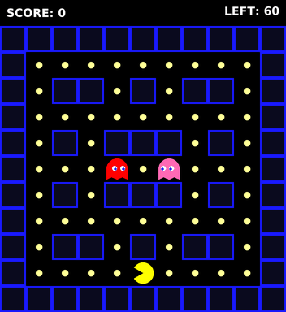

# envpack: Pacman (`envpack/Pacman-v0`)

A Gymnasium environment for a simplified Pacman. Collect every pellet in the maze while avoiding two ghosts. The observation is the full game state, not pixels, so you choose your own features.

## Installation

```bash
pip install -e .
```

## Usage

```python
import gymnasium as gym
import envpack

env = gym.make("envpack/Pacman-v0", maze_size=7)  # 7, 11 or 15
obs, info = env.reset(seed=0)
obs, reward, terminated, truncated, info = env.step(env.action_space.sample())
```

To watch a random agent play, with the live state shown next to the game, run `python play_random.py --size 11`.

## Environment

**Parameters**
- `maze_size`: `7`, `11` or `15`. Default `15`.
- `ghost_speed`: the probability that a ghost moves on a given step. Default `0.8`.
- `max_steps`: default `200`, `500` or `1000`, depending on maze size.
- `render_mode`: `None`, `"rgb_array"` or `"ansi"`.

**Action Space**: `Discrete(4)`
- `0`: Up, `1`: Down, `2`: Left, `3`: Right.
- Moving into a wall leaves Pacman in place.

**Observation Space**: `Dict` containing the following keys. They are the same for every maze size, and positions are `(row, col)`.
- `'walls'`: `Box(0, 1, (H, W), int8)`, where 1 is a wall.
- `'pellets'`: `Box(0, 1, (H, W), int8)`, where 1 is a pellet not yet eaten.
- `'pacman_position'`: `Box(2,)`, Pacman's cell.
- `'pacman_direction'`: `Discrete(4)`, the last direction Pacman moved.
- `'ghost_positions'`: `Box(2, 2)`. Row 0 is the Chaser and row 1 is the Ambusher.

**Mechanics**
- There is a pellet on every open cell except Pacman's start cell. Pacman has one life.
- **Chaser**: follows the shortest path to Pacman.
- **Ambusher**: heads for the cell a few steps ahead of Pacman in the direction it is moving (2, 3 or 4 steps, by maze size). It chases Pacman directly once it gets close.
- When a ghost has several equally good moves, it picks one at random. The randomness is seeded by `reset(seed=...)`.
- **Rewards**: `+10` per pellet, `-0.01` per step, `-100` when caught, `+500` for clearing the maze.
- `terminated` is true when Pacman is caught or all pellets are eaten. `truncated` is true when the episode reaches `max_steps`.
- **Info**: `score`, `steps`, `pellets_eaten`, `pellets_total`, `completion`, `termination_reason` (`"caught"`, `"cleared"`, `"max_steps"` or `None`) and `action_mask`.

**Gameplay** (random agent, 11×11)



## Tests

```bash
python -m unittest envpack.envs.game_pacman.env_test -v
```
